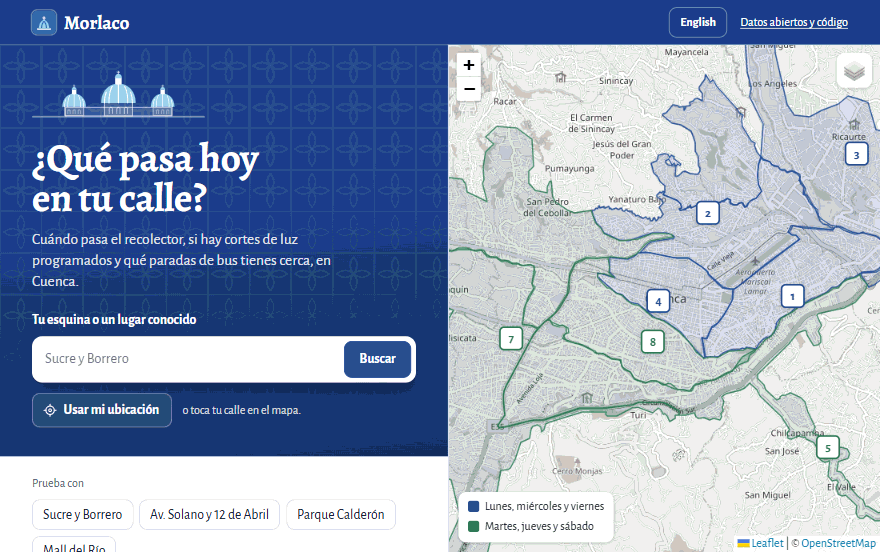
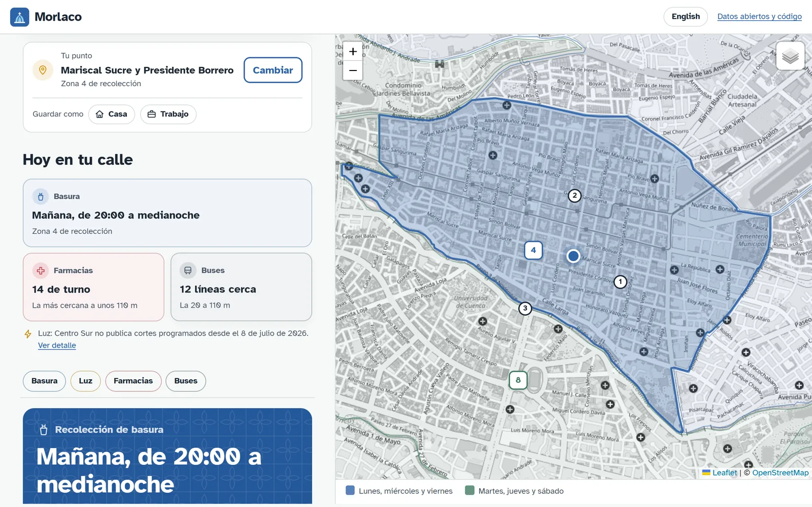
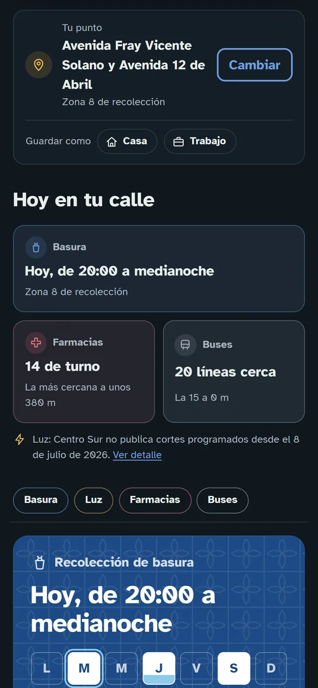

<h1 align="center">
  <br>
  Morlaco
</h1>

<h3 align="center">¿Qué pasa hoy en tu calle? Basura, cortes de luz y buses de Cuenca, Ecuador.</h3>

<p align="center">
  <a href="https://nezusas.github.io/morlaco/web/"><b>Abrir Morlaco</b></a> ·
  <a href="#qué-datos-hay">Los datos</a> ·
  <a href="CONTRIBUTING.md">Colaborar</a> ·
  <a href="https://github.com/NezuSas/morlaco/issues/new/choose">Avisar de un error</a>
</p>

<p align="center">
  <a href="https://nezusas.github.io/morlaco/web/">
    
  </a>
</p>

Escribe tu esquina como se dan las direcciones en Cuenca ("Sucre y Borrero") y Morlaco te dice:

- **Cuándo pasa el recolector** por tu calle, qué funda sacar y qué día va la funda celeste. Con un toque te
  suscribes al **calendario de tu zona** y recibes un aviso antes de cada recolección.
- **Si hay cortes de luz programados** por Centro Sur para hoy.
- **Qué paradas de bus tienes cerca** y a cuántos metros están.

Todo sale de **fuentes oficiales y públicas** (EMAC EP, Centro Sur, el portal Cuenca en Datos del municipio y
OpenStreetMap), y los datos limpios quedan aquí, abiertos, para que cualquiera construya encima: una web, un bot,
una app o un análisis.

<table>
  <tr>
    <td width="68%"></td>
    <td width="32%"></td>
  </tr>
</table>

> Morlaco **no es un servicio oficial** ni está afiliado a EMAC EP, Centro Sur, ETAPA EP ni al GAD
> Municipal de Cuenca. Cada archivo indica de dónde salió. Ante cualquier duda, manda la fuente oficial.

## Qué datos hay

| Archivo | Qué contiene | Fuente |
|---|---|---|
| [`datos/recoleccion/zonas.geojson`](datos/recoleccion/zonas.geojson) | Las 8 zonas de recolección de basura (polígonos) con sus días, horario y día de recolección de reciclables | [EMAC EP, mapa de zonas](https://emac.gob.ec/mapa-zonas-de-recoleccion/) |
| [`datos/recoleccion/calendarios/zona-N.ics`](datos/recoleccion/calendarios/) | Un calendario por zona (iCalendar) con los días de recolección, el día de la funda celeste y un aviso una hora antes, para suscribirse desde Google Calendar, el iPhone u Outlook | Generado a partir de las zonas de EMAC EP |
| [`datos/luz/suspensiones.json`](datos/luz/suspensiones.json) | Suspensiones programadas del servicio eléctrico: alimentador, dirección, hora de inicio y de fin, trabajo | [Centro Sur, suspensiones programadas](https://www.centrosur.gob.ec/suspensiones-programadas/) |
| [`datos/buses/rutas.json`](datos/buses/rutas.json) | Líneas de bus con compañía, origen, destino, horario e intervalo entre buses (lunes a viernes, sábados, domingos) | [Cuenca en Datos](https://cuencaendatos.cuenca.gob.ec/dataset/f15c8808-0d12-4f97-bfd4-3b2f85ea84d1) |
| [`datos/buses/recorridos.json`](datos/buses/recorridos.json) | Puntos por los que pasa cada línea, en orden, de ida y de retorno | [Cuenca en Datos](https://cuencaendatos.cuenca.gob.ec/dataset/4c727738-890e-445c-9b20-32df271db766) |
| [`datos/buses/paradas.geojson`](datos/buses/paradas.geojson) | Paradas de bus con coordenadas corregidas y si tienen señal (paleta) | [Cuenca en Datos](https://cuencaendatos.cuenca.gob.ec/dataset/d98292ca-7c70-422a-ac6f-1b43194ff5ba) |
| [`datos/calles/calles.geojson`](datos/calles/calles.geojson) | Las calles de Cuenca con nombre (unas 2.800), con su trazado simplificado y sus nombres alternativos, para buscar direcciones e intersecciones | [OpenStreetMap](https://www.openstreetmap.org) |
| [`datos/estado.json`](datos/estado.json) | Cuándo se actualizó cada fuente por última vez y si hubo errores | — |

Todos los archivos se pueden descargar directamente desde
`https://nezusas.github.io/morlaco/datos/...`, por ejemplo
<https://nezusas.github.io/morlaco/datos/recoleccion/zonas.geojson>.

### Ejemplo: una zona de recolección

```json
{
  "zona": 4,
  "nombre": "Zona 4",
  "dias": ["lunes", "miércoles", "viernes"],
  "dias_iso": [1, 3, 5],
  "desde": "20:00",
  "hasta": "24:00",
  "dia_reciclaje": "miércoles"
}
```

Para saber la zona de una dirección, basta con comprobar en qué polígono cae su coordenada. Por ejemplo, el
Parque Calderón está en la zona 4.

### Lo que hay que saber de cada fuente

- **Recolección (EMAC).** Viene del mapa de Google que EMAC publica en su web. Según EMAC, la funda
  celeste (reciclables) se recoge los miércoles o los jueves; `dia_reciclaje` indica cuál toca en cada zona.
  Con las mismas zonas se generan los calendarios `.ics`: quien se suscribe recibe los cambios de horario
  sin hacer nada, porque su app vuelve a leer el archivo cada día.
- **Cortes de luz (Centro Sur).** Se leen de los PDF diarios que Centro Sur publica. Las direcciones son texto
  tal como lo escribe Centro Sur, sin coordenadas. **En noviembre de 2026 la página no se actualizaba desde
  julio**: revisa `metadata.ultima_publicacion` antes de fiarte de estos datos.
- **Buses (municipio).** Se toma siempre el CSV más reciente del portal. En el CSV de paradas las coordenadas
  vienen mal formateadas (`-2.895.956` en vez de `-2.895956`); Morlaco las corrige y descarta las que caen
  fuera de Cuenca (`metadata.descartadas`). No hay posiciones de buses en tiempo real: no son públicas.
- **Calles (OpenStreetMap).** Se descargan con la API Overpass todas las vías con nombre de la ciudad, se
  agrupan por nombre y se simplifica su trazado con 4 m de tolerancia. Overpass a veces está saturado; si
  falla, basta con volver a correr `morlaco actualizar calles`.
- **Cortes de agua (ETAPA).** Todavía no están. ETAPA los anuncia en redes sociales y en prensa, no en un
  formato que se pueda leer de forma fiable.

## La página web

En [`web/`](web/) hay una página que usa estos datos, publicada en
<https://nezusas.github.io/morlaco/web/>: escribes tu dirección, compartes tu ubicación o tocas
el mapa, y te dice cuándo pasa el recolector (y si toca funda celeste), si hay cortes de luz programados y
qué paradas de bus tienes cerca. El punto elegido queda en la dirección de la página
(`web/#-2.89733,-79.00454`), así que se puede compartir. Desde la respuesta te puedes suscribir al
calendario de recolección de tu zona.

Las direcciones se escriben como se dan en Cuenca, con dos calles que se cruzan: "Sucre y Borrero",
"Av. Solano y Remigio Crespo", "Bolívar esquina Benigno Malo". La búsqueda se hace dentro de la página con el
índice de calles: no importan las tildes ni las mayúsculas, tolera una letra de más o de menos y entre calles
con nombre parecido elige la que de verdad cruza a la otra. Si escribes una sola calle larga, la marca en el
mapa y te pide la calle que la cruza. Solo cuando lo escrito no es una calle (un parque, un centro
comercial) se pregunta a Nominatim de OpenStreetMap.

Para verla en tu computadora, sirve la carpeta del proyecto (no solo `web/`, porque lee los datos de
`datos/`) y abre <http://127.0.0.1:8765/web/>:

```bash
.venv/Scripts/python -m http.server 8765 --bind 127.0.0.1
```

Usa [Leaflet](https://leafletjs.com) y los mapas de OpenStreetMap. Los lugares que no son calles se ubican
con [Nominatim](https://nominatim.org), limitado a la ciudad de Cuenca; la página lo avisa al pie. No usa
cookies ni analítica: solo recuerda en el navegador el último punto elegido.

## Uso

Requiere Python 3.10 o superior.

```bash
python -m venv .venv
.venv/Scripts/python -m pip install -e ".[dev]"     # en Linux o macOS: .venv/bin/python
```

Actualizar todos los datos (escribe en `datos/`):

```bash
.venv/Scripts/python -m morlaco actualizar
```

O solo algunas fuentes: `recoleccion`, `luz`, `buses`, `calles`.

```bash
.venv/Scripts/python -m morlaco actualizar recoleccion buses
```

Si una fuente falla, las demás se actualizan igual, el comando termina con código 1 y el error queda en
`datos/estado.json` junto con la fecha de la última actualización buena. Los archivos de datos no llevan la
fecha de generación, así que solo cambian cuando cambia la fuente.

## Desarrollo

```bash
.venv/Scripts/python -m pytest
.venv/Scripts/python -m ruff check .
.venv/Scripts/python -m ruff format --check .
node --test "tests/web/*.test.mjs"
```

Las pruebas no usan la red: el parseo de cada fuente son funciones puras que se prueban con ejemplos (el PDF
de Centro Sur de `tests/fixtures` es uno real). En la web pasa lo mismo: `web/logica.js` y `web/calles.js` no
tocan el DOM ni la red, y sus pruebas corren con Node 20 o superior.

```
src/morlaco/
  red.py              descargas HTTP con reintentos (lo único que toca la red)
  comun.py            texto, horas, días y meses
  salida.py           escritura de JSON, GeoJSON y texto
  calendario.py       calendarios .ics de recolección por zona
  cli.py              comando "morlaco actualizar"
  fuentes/
    emac.py           zonas de recolección (KML)
    centrosur.py      suspensiones de luz (PDF)
    buses.py          rutas, recorridos y paradas (API CKAN del portal municipal)
    calles.py         índice de calles (API Overpass de OpenStreetMap)
web/
  index.html          la página
  logica.js           zonas, próxima recolección, cortes de hoy, paradas cercanas (sin DOM)
  calles.js           búsqueda de calles e intersecciones (sin DOM)
  app.js              mapa, búsqueda y pintado de la respuesta
  estilos.css
```

Para añadir una fuente: crea un módulo en `fuentes/` con una función `obtener(descargar) -> Resultado`,
regístrala en `FUENTES` de `cli.py` y añade sus pruebas.

## Próximos pasos

- Convertir las rutas de bus al formato GTFS: dibujar cada línea en el mapa, responder "¿qué bus me lleva?" y
  que Cuenca tenga rutas de bus en las apps de transporte.
- Versión en inglés para la comunidad extranjera de Cuenca.
- Instalar la página en el móvil y usarla sin conexión.
- Capas del portal municipal: BiciPública, ciclovías y carga de autos eléctricos.
- Farmacias de turno, si hay una fuente pública fiable.
- Cortes de agua de ETAPA y un bot de Telegram.

## Colaborar

Puedes ayudar sin programar: [avisa si no encuentra tu esquina](https://github.com/NezuSas/morlaco/issues/new?template=direccion.yml),
[si un dato está mal](https://github.com/NezuSas/morlaco/issues/new?template=dato.yml) o
[propón una idea](https://github.com/NezuSas/morlaco/issues/new?template=idea.yml). Si programas, la
[guía para colaborar](CONTRIBUTING.md) explica cómo preparar el proyecto y tiene tareas para empezar.

Las universidades de Cuenca piden horas de vinculación con la sociedad: Morlaco es un buen lugar para hacerlas.

## Licencia de los datos

El código es software libre bajo la [licencia MIT](LICENSE).

Los datos mantienen la licencia de su fuente. Los conjuntos del portal Cuenca en Datos (rutas, recorridos,
paradas y el mapa de zonas de recolección) están publicados bajo **Creative Commons No Comercial**: se
pueden usar y compartir citando la fuente, pero no con fines comerciales. Los PDF de Centro Sur son
información pública de su web.

El índice de calles (`datos/calles/`) es una base de datos derivada de OpenStreetMap y se distribuye bajo la
[Open Database License (ODbL) 1.0](https://opendatacommons.org/licenses/odbl/): © colaboradores de
OpenStreetMap. Quien lo reutilice debe citar a OpenStreetMap y compartir sus mejoras bajo la misma licencia.
