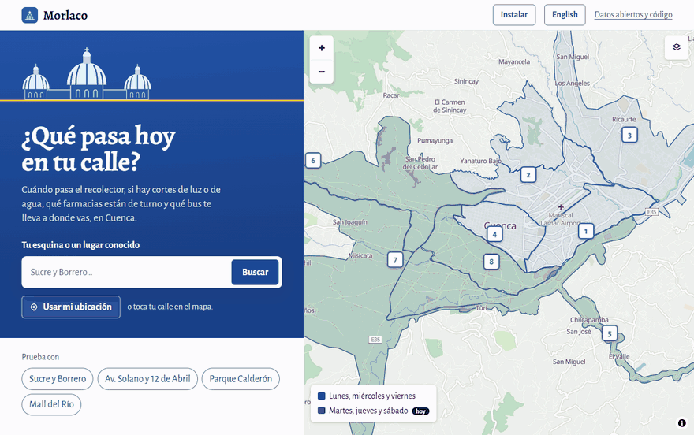
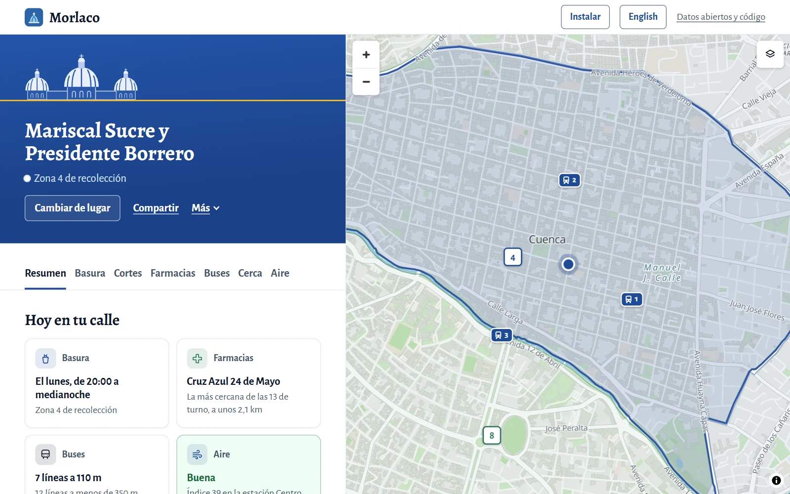
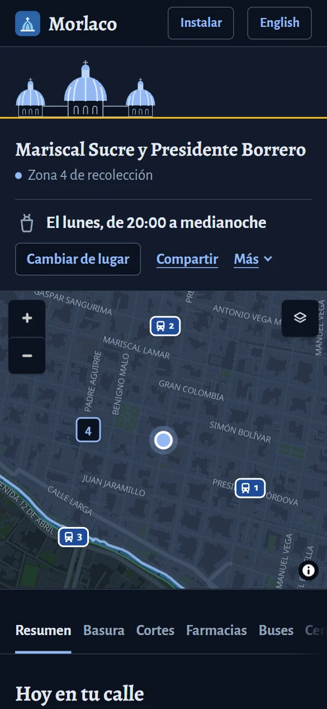
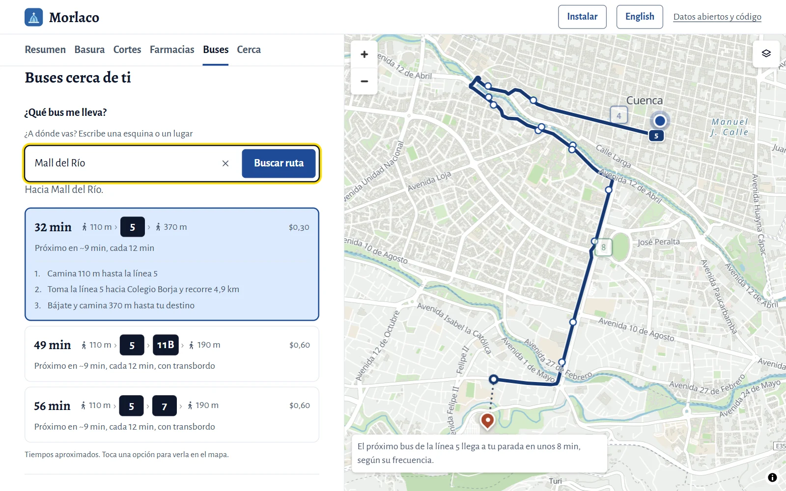
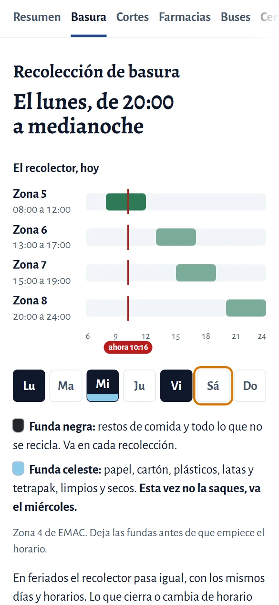

<h1 align="center">
  <br>
  Morlaco
</h1>

<h3 align="center">¿Qué pasa hoy en tu calle? Basura, luz, agua, farmacias, buses y aire de Cuenca, Ecuador.</h3>

<p align="center">
  <a href="https://nezusas.github.io/morlaco/web/"><b>Abrir Morlaco</b></a> |
  <a href="https://nezusas.github.io/morlaco/web/datos.html">Datos abiertos</a> |
  <a href="CONTRIBUTING.md">Colaborar</a> |
  <a href="https://github.com/NezuSas/morlaco/issues/new/choose">Avisar de un error</a>
</p>

<p align="center">
  <a href="https://nezusas.github.io/morlaco/web/">
    
  </a>
</p>

Morlaco es una página web gratuita para quien vive en Cuenca. Escribes tu esquina y te dice, en una sola
pantalla, lo que hoy hay que buscar en seis sitios distintos: cuándo pasa el recolector, si te van a cortar
la luz o el agua, qué farmacia está de turno, qué bus te lleva y cómo está el aire.

No pide cuenta, no tiene publicidad y no guarda nada tuyo en ningún servidor. Los datos salen de fuentes
públicas y quedan aquí, abiertos, para que cualquiera los use.

> Morlaco **no es un servicio oficial** ni está afiliado a EMAC EP, Centro Sur, ETAPA EP ni al GAD
> Municipal de Cuenca. Cada archivo indica de dónde salió. Ante cualquier duda, manda la fuente oficial.

## Contenido

**Para usar la página**

- [Cómo se usa](#cómo-se-usa)
- [Qué te responde](#qué-te-responde)
- [Qué más hace](#qué-más-hace)
- [Privacidad](#privacidad)
- [De dónde salen los datos](#de-dónde-salen-los-datos)
- [In English](#in-english)

**Para usar los datos**

- [Qué datos hay](#qué-datos-hay)
- [Buses en formato GTFS](#buses-en-formato-gtfs)

**Para entender o cambiar el proyecto**

- [Cómo funciona la página](#cómo-funciona-la-página)
- [Uso](#uso)
- [Desarrollo](#desarrollo)
- [Próximos pasos](#próximos-pasos)
- [Quién lo hace](#quién-lo-hace), [Colaborar](#colaborar) y [Licencia de los datos](#licencia-de-los-datos)

## Cómo se usa

1. **Abre** <https://nezusas.github.io/morlaco/web/> en el celular o en la computadora.
2. **Di dónde estás**, de una de tres formas:
   - escribe tu esquina como se dan las direcciones en Cuenca: "Sucre y Borrero", "Av. Solano y Remigio
     Crespo". Mientras escribes, la página sugiere calles; después de la "y" solo propone las que de verdad
     cruzan a la primera;
   - toca **Usar mi ubicación**;
   - o toca tu calle en el mapa.
3. **Lee el resumen** "Hoy en tu calle" y, si quieres el detalle, entra a la pestaña de cada servicio.

La próxima vez que abras la página, vuelve sola a tu calle.

<table>
  <tr>
    <td width="68%"></td>
    <td width="32%"></td>
  </tr>
  <tr>
    <td align="center">En la computadora, la respuesta a la izquierda y el mapa a la derecha.</td>
    <td align="center">En el celular, con el modo oscuro del sistema.</td>
  </tr>
</table>

## Qué te responde

La respuesta está repartida en pestañas. **Resumen** junta lo principal en fichas; cada ficha lleva a su
pestaña.

| Pestaña | Lo que te dice |
|---|---|
| **Resumen** | Cuándo pasa el recolector, la farmacia de turno más cercana con su nombre, las líneas de bus que pasan por tu esquina y la calidad del aire. Cada ficha se tiñe según su estado: ámbar si el recolector pasa hoy, verde si todo está bien, rojo si hay un aviso. |
| **Basura** | Los días y el horario de tu zona, cuánto falta para que empiece (cuando ya falta poco), el recorrido del recolector por la ciudad hoy, qué va en la funda negra y en la celeste y qué día toca la celeste. También qué pasa en feriados y dónde llevar lo que no va en las fundas (orgánicos, vidrio, escombros, pilas). |
| **Cortes** | Los cortes de luz programados por Centro Sur para hoy, y si publicó cronogramas nuevos. Debajo, los cortes de agua anunciados por ETAPA para los próximos días, con sus sectores y horario. |
| **Farmacias** | Las farmacias de turno de la semana (abiertas las 24 horas), ordenadas por cercanía, con su teléfono para llamar con un toque, un botón para verlas en el mapa y otro para que Google Maps te lleve. |
| **Buses** | Qué bus te lleva a donde vas, las líneas que pasan cerca y cada cuánto pasan hoy, su recorrido en el mapa, las paradas y la estación del tranvía más cercanas, el pasaje vigente y los cambios recientes de líneas. |
| **Cerca** | La zona WiFi gratis, el mercado, el punto para dejar pilas y el destacamento de la Guardia Ciudadana más cercanos, con su horario o su teléfono, y la estación de BiciPública más cercana. |
| **Aire** | El índice de calidad del aire de la estación de la EMOV más cercana, con su recomendación, el índice UV y la temperatura. |

### ¿Qué bus me lleva?

En la pestaña **Buses** escribes a dónde vas y la página propone varias formas de llegar: con una línea
directa, con un transbordo o a pie. Cada opción dice cuánto tarda, cuánto se camina, cuánto cuesta y cuándo
pasa el próximo bus, y la que eliges se dibuja en el mapa con sus paradas. Si a esa hora la línea ya no
pasa, lo dice, y de madrugada indica a qué hora pasa el primero.

Si escribes solo una calle ("Av. Solano"), ves las líneas que la recorren.

<table>
  <tr>
    <td width="68%"></td>
    <td width="32%"></td>
  </tr>
  <tr>
    <td align="center">Una ruta al Mall del Río: las opciones a la izquierda y el recorrido en el mapa.</td>
    <td align="center">La pestaña Basura, con el recorrido del día.</td>
  </tr>
</table>

### En el mapa

El mapa muestra las zonas de recolección (resaltadas las que tienen recolección hoy), tu punto, las paradas
y los buses que vienen según su frecuencia. Con el botón de capas se prenden las estaciones del tranvía, la
BiciPública, las ciclovías y los puntos de carga para autos eléctricos.

## Qué más hace

- **Avisarte antes de cada recolección.** Desde la pestaña Basura te suscribes al calendario de tu zona
  (Google Calendar, iPhone u Outlook) y recibes un aviso una hora antes. Si EMAC cambia el horario, el
  calendario se actualiza solo.
- **Compartir tu calle.** El botón Compartir abre el menú de tu teléfono; en la computadora copia el enlace.
  En "Más" está el envío directo por WhatsApp.
- **Guardar dos lugares**, Casa y Trabajo, para volver a ellos con un toque.
- **Instalarse como app** en el celular o la computadora. En Android y en Chrome o Edge aparece el botón
  "Instalar"; en el iPhone, desde Safari, con Compartir y "Añadir a pantalla de inicio".
- **Funcionar sin conexión** con los últimos datos descargados, útil en un corte de luz o sin megas.
- **Hablar español e inglés.** Elige el idioma del navegador y tiene un botón para cambiarlo.
- **Imprimir la hoja de tu zona**, con los días de recolección y las farmacias de turno, para la
  refrigeradora o la cartelera del edificio.
- **Un [cartel con código QR](https://nezusas.github.io/morlaco/web/cartel.html)** para la puerta de un
  edificio, una tienda o la casa comunal.
- **Páginas simples, sin mapa**, para quien llega desde un buscador: el
  [horario de la basura por zona](https://nezusas.github.io/morlaco/web/info/), las farmacias de turno y los
  cortes de agua.

## Privacidad

- **No hay cuentas, cookies ni analítica.**
- La página recuerda **solo en tu navegador** el último punto que consultaste, tus dos lugares y el idioma.
  En "Más", "Borrar dirección" quita el punto guardado.
- Las direcciones se buscan **dentro de la página**, con un índice de calles que se descarga una vez. Solo
  cuando lo que escribes no es una calle (un parque, un centro comercial) el texto se envía a Nominatim, de
  OpenStreetMap, para ubicarlo.
- La calidad del aire se pide a la web de la EMOV **sin enviarle tu ubicación**: la estación más cercana se
  elige en tu navegador.
- El mapa pide su programa (MapLibre) a unpkg y sus imágenes a OpenFreeMap, como cualquier mapa en línea.

## De dónde salen los datos

Todo sale de **fuentes oficiales y públicas** y, cuando una institución solo lo anuncia en redes, de la
**prensa local** que la cita, revisada a mano.

| Servicio | Fuente | Qué tan al día está |
|---|---|---|
| Recolección de basura | EMAC EP, mapa de zonas | Se revisa todos los días |
| Cortes de luz | Centro Sur, suspensiones programadas | Se revisa todos los días, pero **Centro Sur no actualiza su cronograma desde julio de 2026**; la página lo dice |
| Cortes de agua | ETAPA EP, a través de El Mercurio | Se busca todos los días y una persona confirma cada corte antes de mostrarlo |
| Farmacias de turno | ARCSA, lista mensual de Azuay | Se revisa todos los días |
| Buses | GAD Municipal, portal Cuenca en Datos | Horarios de 2025 y recorridos de 2022: manda el letrero del bus |
| Tranvía | Tranvía de Cuenca | Se revisa todos los días |
| Aire, sol y temperatura | Red de Monitoreo de la EMOV EP | En vivo, cada vez que abres la página |
| Calles, ciclovías, BiciPública | OpenStreetMap | Se revisa cada lunes |

El mapa completo de dónde está cada dato, qué tan al día está y qué no tiene fuente vive en
[`docs/fuentes.md`](docs/fuentes.md). Los detalles y los errores conocidos de cada fuente están más abajo, en
[Lo que hay que saber de cada fuente](#lo-que-hay-que-saber-de-cada-fuente).

## In English

Morlaco tells you what's happening today on your street in Cuenca, Ecuador: when the garbage truck comes,
planned power and water cuts, on-duty pharmacies, nearby buses, the tram and air quality. The
[website](https://nezusas.github.io/morlaco/web/) is available in Spanish and English, with simple
[pages](https://nezusas.github.io/morlaco/web/info/en/) for each garbage zone, on-duty pharmacies and water
cuts, and a [printable poster](https://nezusas.github.io/morlaco/web/cartel.html?lang=en) with a QR code.

All the data is open: static JSON, GeoJSON, GTFS and iCalendar files at
`https://nezusas.github.io/morlaco/datos/`, readable from any program or website (open CORS) and updated
every day. The [open data page](https://nezusas.github.io/morlaco/web/datos.html) explains how to use them,
and the [catalogue](https://nezusas.github.io/morlaco/datos/indice.json) describes every file in Spanish and
English. Field names are in Spanish. Each file keeps its source's license (see below); what Morlaco compiles by
hand is CC BY 4.0. Morlaco is built and maintained by [Nezu S.A.S.](https://www.nezuecuador.com/) in Cuenca
and is not an official service.

## Qué datos hay

Los datos limpios se publican como archivos estáticos para que cualquiera construya encima: una web, un
bot, una app o un análisis.

| Archivo | Qué contiene | Fuente |
|---|---|---|
| [`datos/recoleccion/zonas.geojson`](datos/recoleccion/zonas.geojson) | Las 8 zonas de recolección de basura (polígonos) con sus días, horario y día de recolección de reciclables | [EMAC EP, mapa de zonas](https://emac.gob.ec/mapa-zonas-de-recoleccion/) |
| [`datos/recoleccion/calendarios/zona-N.ics`](datos/recoleccion/calendarios/) | Un calendario por zona (iCalendar) con los días de recolección, el día de la funda celeste y un aviso una hora antes, para suscribirse desde Google Calendar, el iPhone u Outlook | Generado a partir de las zonas de EMAC EP |
| [`datos/luz/suspensiones.json`](datos/luz/suspensiones.json) | Suspensiones programadas del servicio eléctrico: alimentador, dirección, hora de inicio y de fin, trabajo. En `otras_publicaciones`, los cronogramas sueltos recientes: fecha, provincias y si mencionan Cuenca | [Centro Sur, suspensiones programadas](https://www.centrosur.gob.ec/suspensiones-programadas/) y [programación de cortes](https://www.centrosur.gob.ec/intermedia-programacion/) |
| [`datos/buses/rutas.json`](datos/buses/rutas.json) | Líneas de bus con compañía, origen, destino, horario e intervalo entre buses (lunes a viernes, sábados, domingos) | [Cuenca en Datos](https://cuencaendatos.cuenca.gob.ec/dataset/f15c8808-0d12-4f97-bfd4-3b2f85ea84d1) |
| [`datos/buses/recorridos.json`](datos/buses/recorridos.json) | Puntos por los que pasa cada línea, en orden, de ida y de retorno: en `sentidos`, tal como los publica el municipio; en `pasa_por`, con el nombre pulido para mostrarlos | [Cuenca en Datos](https://cuencaendatos.cuenca.gob.ec/dataset/4c727738-890e-445c-9b20-32df271db766) |
| [`datos/buses/lineas.geojson`](datos/buses/lineas.geojson) | Recorrido de las 38 líneas de bus, los alimentadores y el tranvía en cada sentido, con sus alargues | [Cuenca en Datos](https://cuencaendatos.cuenca.gob.ec/dataset/f15c8808-0d12-4f97-bfd4-3b2f85ea84d1) |
| [`datos/gtfs/cuenca-buses.zip`](datos/gtfs/cuenca-buses.zip) | **Feed GTFS** de los buses urbanos (38 líneas, frecuencias de lunes a viernes, sábados y domingos), validado sin errores con el validador oficial de MobilityData | Generado a partir de los datos del municipio |
| [`datos/buses/paradas.geojson`](datos/buses/paradas.geojson) | Paradas de bus con coordenadas corregidas y si tienen señal (paleta) | [Cuenca en Datos](https://cuencaendatos.cuenca.gob.ec/dataset/d98292ca-7c70-422a-ac6f-1b43194ff5ba) |
| [`datos/buses/tranvia.geojson`](datos/buses/tranvia.geojson) | Las 20 estaciones del tranvía, con un punto por andén y el sentido en que para en cada una | [Tranvía de Cuenca](https://tranvia.cuenca.gob.ec/) |
| [`datos/manual/transporte.json`](datos/manual/transporte.json) | **Mantenido a mano**: pasaje del bus y del tranvía, cambios de líneas de 2026 (con fecha de caducidad) y frecuencia del tranvía, cada dato con su fuente | Comunicados del municipio publicados en [El Mercurio](https://elmercurio.com.ec/cuenca/) |
| [`datos/ciudad/cerca.geojson`](datos/ciudad/cerca.geojson) | Zonas WiFi gratis, mercados (con horario), puntos para dejar pilas usadas y destacamentos de la Guardia Ciudadana (con teléfono), con las coordenadas corregidas | [Cuenca en Datos](https://cuencaendatos.cuenca.gob.ec) |
| [`datos/agua/avisos.json`](datos/agua/avisos.json) | Notas de prensa de las últimas tres semanas que anuncian un corte de agua, **por confirmar** (la página no las muestra) | [El Mercurio](https://elmercurio.com.ec/cuenca/) |
| [`datos/manual/agua.json`](datos/manual/agua.json) | **Mantenido a mano**: cortes de agua confirmados (fecha, horario, sectores y la nota de prensa que cita a ETAPA) y las notas descartadas | El Mercurio, a partir de [`datos/agua/avisos.json`](datos/agua/avisos.json) |
| [`datos/manual/basura.json`](datos/manual/basura.json) | **Mantenido a mano**: qué pasa con la recolección en feriados, qué va en la funda celeste y dónde llevar orgánicos, vidrio, escombros, pilas y objetos grandes, cada dato con su fuente | Páginas de [EMAC EP](https://emac.gob.ec) y [ETAPA EP](https://www.etapa.net.ec) y comunicados en prensa |
| [`datos/manual/feriados.json`](datos/manual/feriados.json) | **Mantenido a mano**: los próximos días de descanso en Cuenca (feriados nacionales, el local de Cuenca y las suspensiones de jornada por decreto), ya en el día en que se descansa, cada uno con su fuente | Decretos y calendario oficial publicados en prensa |
| [`datos/feriados/avisos.json`](datos/feriados/avisos.json) | Notas de prensa de los últimos 30 días que anuncian un día de descanso, un feriado decretado o un traslado, **por revisar** (la página no las muestra) | [El Mercurio](https://elmercurio.com.ec/) |
| [`datos/calles/calles.geojson`](datos/calles/calles.geojson) | Las calles de Cuenca con nombre (unas 2.800), con su trazado simplificado y sus nombres alternativos, para buscar direcciones e intersecciones | [OpenStreetMap](https://www.openstreetmap.org) |
| [`datos/farmacias/turnos.json`](datos/farmacias/turnos.json) | Farmacias de turno de Cuenca por semana (de 06:00 a 06:00), con dirección legible y teléfono para llamar | [ARCSA, turnos de farmacias](https://www.controlsanitario.gob.ec/turnos-de-farmacias/) |
| [`datos/movilidad/`](datos/movilidad/) | Estaciones de BiciPública (BiciCuenca) con su capacidad, ciclovías (separadas o carriles pintados) y puntos de carga para autos eléctricos (públicos, para clientes o privados) | [OpenStreetMap](https://www.openstreetmap.org) |
| [`datos/estado.json`](datos/estado.json) | Cuándo se actualizó cada fuente por última vez y si hubo errores | — |
| [`datos/indice.json`](datos/indice.json) | **Catálogo** legible por programas: cada archivo con su descripción, sus campos principales, su frecuencia, su fuente y su licencia | — |

### Usar los datos desde otro programa

Todos los archivos se pueden leer directamente desde `https://nezusas.github.io/morlaco/datos/...`, por ejemplo
<https://nezusas.github.io/morlaco/datos/recoleccion/zonas.geojson>, sin claves ni registro y también desde
otra página web (el servidor envía `Access-Control-Allow-Origin: *`). La página
[**Datos abiertos**](https://nezusas.github.io/morlaco/web/datos.html) los explica con ejemplos.

**Estabilidad (versión 1).** Los campos que lista el catálogo no cambian de nombre ni de tipo, ni desaparecen,
sin aviso; se pueden añadir campos nuevos, así que un programa debe ignorar los que no conozca. Un cambio
incompatible sube `version` en `indice.json` y se anuncia aquí al menos 30 días antes. El catálogo sale de
[`src/morlaco/catalogo.py`](src/morlaco/catalogo.py) y una prueba comprueba que describa todo lo que se publica.

### Ejemplo: una zona de recolección

```json
{
  "zona": 4,
  "nombre": "Zona 4",
  "dias": ["lunes", "miércoles", "viernes"],
  "dias_iso": [1, 3, 5],
  "desde": "20:00",
  "hasta": "24:00",
  "dia_reciclaje": "miércoles"
}
```

Para saber la zona de una dirección, basta con comprobar en qué polígono cae su coordenada. Por ejemplo, el
Parque Calderón está en la zona 4.

### Lo que hay que saber de cada fuente

En [`docs/fuentes.md`](docs/fuentes.md) está el mapa completo: para cada servicio, dónde se publica hoy, qué
tan al día está, si se puede leer automáticamente y qué no tiene fuente.

- **Recolección (EMAC).** Viene del mapa de Google que EMAC publica en su web. Según EMAC, la funda
  celeste (reciclables) se recoge los miércoles o los jueves; `dia_reciclaje` indica cuál toca en cada zona.
  Con las mismas zonas se generan los calendarios `.ics`: quien se suscribe recibe los cambios de horario
  sin hacer nada, porque su app vuelve a leer el archivo cada día.
- **Feriados y dónde llevar cada cosa (a mano).** EMAC no lo publica en datos abiertos, así que
  [`datos/manual/basura.json`](datos/manual/basura.json) se edita a mano a partir de sus páginas, las de ETAPA
  y lo que informa a la prensa antes de cada feriado. El aviso de feriados tiene fecha `hasta`. Lo que la
  fuente no dice (por ejemplo, un servicio para muebles viejos) se dice tal cual, sin completar.
- **Próximos días de descanso (a mano).** [`datos/manual/feriados.json`](datos/manual/feriados.json) lista
  cada día en que se descansa, ya trasladado según la Ley de Feriados, con su fuente. La página muestra el
  próximo en la sección de basura cuando faltan tres semanas o menos, y la revisión diaria avisa un mes
  antes de que se acabe la lista. Los días de descanso por decreto se anuncian con solo dos o tres semanas:
  cada lunes, `morlaco actualizar feriados` busca en El Mercurio las notas que anuncian uno y las guarda en
  `datos/feriados/avisos.json` sin mostrarlas. La revisión diaria lista las publicadas desde la última
  revisión de la lista hasta que una persona añade el día, con la nota como fuente, o pone el enlace en
  `descartados`.
- **Cortes de luz (Centro Sur).** Se leen de los PDF diarios que Centro Sur publica. Las direcciones son texto
  tal como lo escribe Centro Sur, sin coordenadas. **En noviembre de 2026 la página no se actualizaba desde
  julio**: revisa `metadata.ultima_publicacion` antes de fiarte de estos datos. Desde octubre de 2026 Centro
  Sur publica además cronogramas sueltos (carteles en PDF, sin tabla) en su página "Programación de cortes";
  Morlaco los busca allí y en la biblioteca de medios del sitio (API de WordPress) y anota de qué día son, de
  qué provincias hablan y si mencionan Cuenca. Si uno menciona Cuenca, la página lo avisa y enlaza el PDF.
- **Tranvía.** Las estaciones salen de la API pública que usa su web. El horario en vivo de la web llega por un
  canal no documentado y no se usa; se muestra la frecuencia publicada (cada 8 minutos entre semana y 15 los
  fines de semana, desde octubre de 2025).
- **Pasaje y cambios de líneas (a mano).** El municipio no publica en datos abiertos el pasaje ni las
  ampliaciones de rutas de 2026, así que [`datos/manual/transporte.json`](datos/manual/transporte.json) se
  edita a mano a partir de comunicados publicados en prensa. Cada aviso tiene fecha `hasta` y deja de mostrarse
  después; `tests/test_manual.py` comprueba que el archivo esté completo antes de publicarlo.
- **Buses (municipio).** Se toma siempre el CSV más reciente del portal. En el CSV de paradas las coordenadas
  vienen mal formateadas (`-2.895.956` en vez de `-2.895956`); Morlaco las corrige y descarta las que caen
  fuera de Cuenca (`metadata.descartadas`). No hay posiciones de buses en tiempo real: no son públicas.
  El recorrido de cada línea sale del shapefile del mismo conjunto (en UTM 17 Sur, convertido a
  latitud y longitud). **El último publicado es de septiembre de 2022**, así que algunas líneas pueden haber
  cambiado; los horarios y frecuencias sí son de 2025. Las líneas 4 y 27 se toman de la
  [IDE del Municipio](https://ide.cuenca.gob.ec/geoserver/ows?service=WFS&request=GetCapabilities) (capas
  `ide:dmt_linea4` y `ide:dmt_linea27`), que coinciden con el recorrido de abril de 2026: la 4 pasa por el Mall
  del Río y el IESS (la del shapefile, por la Feria Libre) y la 27 sube por la Tarqui hasta la Pío Bravo (la del
  shapefile se desvía por la Estévez de Toral).
- **Calles (OpenStreetMap).** Se descargan con la API Overpass todas las vías con nombre de la ciudad, se
  agrupan por nombre y se simplifica su trazado con 4 m de tolerancia. Overpass a veces está saturado; si
  falla, basta con volver a correr `morlaco actualizar calles`.
- **BiciPública, ciclovías y carga eléctrica (OpenStreetMap).** El portal municipal también las publica, pero sus
  versiones actuales vienen en archivos RAR (que necesitan un programa aparte) y los puntos de carga solo como
  enlace a un mapa externo. OpenStreetMap las tiene en un formato abierto y al día.
- **Farmacias de turno (ARCSA).** Se leen del PDF mensual de Azuay. La tabla tiene celdas combinadas y textos
  partidos que Morlaco reconstruye, y **errores de la propia fuente**: años mal escritos (que se corrigen),
  farmacias de otros cantones listadas como de Cuenca (se descartan las que nombran otro cantón) y teléfonos
  de otras provincias o de relleno. La página pide **llamar antes de ir** y enlaza el PDF oficial. Las
  direcciones de esquina se ubican con el índice de calles para ordenar por cercanía.
- **Aire (EMOV).** No se guarda en `datos/`: el índice cambia cada hora, así que la página lo pide en vivo a
  la web de la [Red de Monitoreo de la EMOV EP](https://caire.emov.gob.ec/) (una API sin documentar, con CORS
  abierto). Se muestra la estación más cercana que mide partículas, con la hora del dato; si la EMOV no
  responde en 6 segundos o el dato tiene más de 4 horas, "Aire" no aparece. Su servidor envía el certificado
  sin el intermedio, así que algunos programas (Python, Node) no lo aceptan aunque los navegadores sí. De la
  misma web salen el índice UV y la temperatura, medidos en el Centro Histórico; se muestran si tienen menos
  de dos horas.
- **Cerca de ti (municipio).** WiFi, mercados, pilas y Guardia Ciudadana salen de cuatro CSV del portal Cuenca
  en Datos, cada uno con sus propios errores de coordenadas: `-291,509` por `-2.91509`, UTM con puntos de miles,
  longitudes a las que les falta una cifra. Morlaco recupera lo que puede; los mercados con la longitud rota se
  ubican por su esquina con el índice de calles, y lo que no cae en Cuenca se descarta y se cuenta en
  `metadata.fuentes.<tipo>.descartados`.
- **Cortes de agua (ETAPA y prensa).** ETAPA los anuncia en redes sociales; su web no publica nada desde
  febrero de 2025. El Mercurio sí publica cada aviso. Cada día, `morlaco actualizar agua` busca en su API las
  notas cuyo título anuncia un corte de agua en Cuenca y las guarda en `datos/agua/avisos.json` **sin
  mostrarlas**. Por cada nota nueva, el workflow abre un aviso en GitHub (etiqueta `corte-agua`), y GitHub lo
  manda por correo. Una persona lee la nota y, si es un corte de ETAPA, lo copia a
  [`datos/manual/agua.json`](datos/manual/agua.json) con fecha, horario, sectores y fuente; si no, añade el
  enlace a `descartados`. Solo entonces aparece en la página, hasta que pasa su fecha.

## Buses en formato GTFS

[`datos/gtfs/cuenca-buses.zip`](https://nezusas.github.io/morlaco/datos/gtfs/cuenca-buses.zip) es un feed
[GTFS](https://gtfs.org/es/), el formato estándar de horarios que usan las apps de transporte, con las 38 líneas
de bus urbano de Cuenca. Pasa el [validador oficial de MobilityData](https://gtfs-validator.mobilitydata.org/)
sin errores ni avisos, y el workflow lo vuelve a pasar cada día (versión 8.0.1). Además, la revisión diaria hace
sus propias comprobaciones ([`revisar_gtfs.py`](src/morlaco/revisar_gtfs.py)): que no falte ningún archivo,
que cada referencia lleve a algo que existe, que las paradas avancen en orden y caigan en Cuenca, y que el
calendario no esté por vencer. Cualquier error o aviso del validador sale en «Datos por revisar».

Cómo está hecho, con lo que publica el municipio:

- **Rutas, sentidos y frecuencias** ("cada 9 min de 05:50 a 21:15"), del CSV de rutas (2025). Es un feed de
  frecuencias (`frequencies.txt`): el municipio no publica horarios exactos por parada.
- **Recorridos** (`shapes.txt`), del shapefile de rutas (septiembre de 2022), salvo las líneas 4 y 27, de la IDE.
- **Paradas**: las terminales de cada recorrido y las paradas registradas por el municipio que quedan a menos
  de 25 m del recorrido, en orden.
- **Tiempos entre paradas**: estimados a 15 km/h de media, porque no hay tiempos de viaje publicados.

No incluye el tranvía, los alimentadores ni los alargues, que no tienen horarios en el CSV. Los nombres de las
empresas vienen del CSV; como `agency_url` se usa la web de la EMOV, que regula el transporte.

Para que estas rutas aparezcan en Google Maps, Google pide que el feed lo envíe el operador o la autoridad de
transporte: este archivo puede servir de base para proponérselo a la EMOV o al municipio.

## Cómo funciona la página

En [`web/`](web/) está la página, publicada en <https://nezusas.github.io/morlaco/web/>. Es HTML, CSS y
JavaScript sin dependencias que instalar ni paso de compilación: lee los archivos de `datos/` y lo calcula
todo en el navegador.

**El punto y la dirección de la página.** El punto elegido queda en la dirección
(`web/#-2.89733,-79.00454`) y la pestaña abierta también (`?ver=buses`), así que el enlace que compartes
abre donde tú estabas. Si tocas el mapa o usas tu ubicación, el punto toma el nombre de la esquina más
cercana.

**La búsqueda de direcciones.** Se hace dentro de la página con el índice de calles: no importan las tildes
ni las mayúsculas, tolera una letra de más o de menos y entre calles con nombre parecido elige la que de
verdad cruza a la otra. Si escribes una sola calle larga, la marca en el mapa, te pide la calle que la cruza
y lista **los buses que pasan por ella**: las líneas cuyo trazado va pegado a la calle un buen tramo, no las
que solo la cruzan. Solo cuando lo escrito no es una calle se pregunta a
[Nominatim](https://nominatim.org), limitado a la ciudad de Cuenca.

**El mapa.** Usa [MapLibre GL JS](https://maplibre.org) (licencia BSD) con los mapas vectoriales de
[OpenFreeMap](https://openfreemap.org), hechos con datos de OpenStreetMap y de uso libre, sin clave ni
cuenta. Los colores del mapa base son los de Morlaco, con una paleta para el día y otra para la noche. Lo
dibuja la tarjeta gráfica (WebGL): el zoom es continuo y los recorridos se trazan con una animación; si el
sistema pide reducir el movimiento, no se anima nada. En un navegador sin WebGL la página avisa y las
respuestas salen igual.

**Sin conexión.** El service worker (`web/sw.js`) pide primero la página y los datos a la red y, si no hay
conexión, usa la copia guardada. Guarda también las teselas del mapa ya vistas (hasta 300), con sus letras e
iconos, y nunca las búsquedas de lugares.

**Idiomas.** Los textos de la interfaz están en `web/textos.js`, en español e inglés. Lo que viene de las
fuentes (nombres de calles, paradas y destinos) se queda como se dice en Cuenca.

**Tipografías.** Alegreya y Alegreya Sans, de Huerta Tipográfica, con licencia SIL OFL. Van en
[`web/fuentes/`](web/fuentes/), así que la página no pide nada a servidores de terceros salvo el mapa y la
calidad del aire.

**Páginas simples.** En [`web/info/`](web/info/) (y en inglés en `web/info/en/`) están el horario de la
basura de cada zona, las farmacias de turno de la semana y los cortes de agua anunciados. Son HTML fijo, sin
JavaScript, para que los buscadores las encuentren ("horario de basura zona 4 Cuenca") y lleven a la
página; cada zona tiene su imagen para compartir con el horario. Las escribe `morlaco actualizar` con los
datos del día, junto con el mapa del sitio para buscadores ([`sitemap.xml`](sitemap.xml)). Si EMAC cambia el
horario de una zona, hay que rehacer su imagen en `web/info/img/` (una prueba avisa si falta alguna).

**El cartel.** El [cartel para imprimir](https://nezusas.github.io/morlaco/web/cartel.html) lleva el código
QR de la página. Se imprime en una hoja A4, en español o en inglés, y si eliges una zona dice también a qué
hora pasa la basura (`cartel.html?zona=4`).

**La tarjeta al compartir.** La imagen que sale en WhatsApp o en redes (`web/compartir.png`) se genera
desde [`docs/compartir.html`](docs/compartir.html); ahí mismo está cómo rehacerla.

**Accesibilidad.** Contraste suficiente en claro y en oscuro, navegación con teclado con un enlace para
saltar al contenido, pestañas que se recorren con las flechas, títulos en orden para lectores de pantalla y
controles de buen tamaño.

Para verla en tu computadora, sirve la carpeta del proyecto (no solo `web/`, porque lee los datos de
`datos/`) y abre <http://127.0.0.1:8765/web/>:

```bash
.venv/Scripts/python -m http.server 8765 --bind 127.0.0.1
```

### Cómo se calcula «¿Qué bus me lleva?»

Con el punto elegido y un destino, Morlaco busca, con los recorridos y las frecuencias del municipio:

- **líneas directas**: pasan a menos de 500 m del origen y, más adelante en su recorrido (en el sentido
  correcto), a menos de 500 m del destino;
- **con un transbordo**, si no hay al menos dos directas: dos líneas cuyos recorridos se acercan a menos de
  200 m;
- **a pie**, si el destino está a menos de 1,5 km (se prefiere caminar si tarda casi lo mismo).

El tiempo suma lo que se camina (4,5 km/h), lo que se va en bus (15 km/h) y la espera (media frecuencia de
hoy). De cada línea se muestra una sola opción, la que deja más cerca. Las opciones con un bus que ya no pasa a esa hora quedan al final y lo dicen. El tranvía no tiene horario
publicado: se remite a su web. Todo se calcula en el navegador, en milisegundos (`web/rutas.js`).

## Uso

Requiere Python 3.10 o superior.

```bash
python -m venv .venv
.venv/Scripts/python -m pip install -e ".[dev]"     # en Linux o macOS: .venv/bin/python
```

Actualizar todos los datos (escribe en `datos/`):

```bash
.venv/Scripts/python -m morlaco actualizar
```

O solo algunas fuentes: `recoleccion`, `luz`, `buses`, `calles`, `movilidad`, `farmacias`, `tranvia`,
`agua`, `cerca`.

```bash
.venv/Scripts/python -m morlaco actualizar recoleccion buses
```

Si una fuente falla, las demás se actualizan igual, el comando termina con código 1 y el error queda en
`datos/estado.json` junto con la fecha de la última actualización buena. Los archivos de datos no llevan la
fecha de generación, así que solo cambian cuando cambia la fuente.

### Actualización automática

El workflow [`actualizar-datos.yml`](.github/workflows/actualizar-datos.yml) lo hace solo en GitHub:

- **Todos los días a las 06:00** de Cuenca revisa las fuentes que cambian seguido: `recoleccion`, `luz`,
  `farmacias`, `tranvia` y `agua`.
- **Los lunes a las 06:30** revisa todas y publica aunque no haya cambios, para que conste la revisión.
- Antes de publicar pasa todas las pruebas con los datos nuevos. Si alguna falla, no publica nada.
- Con los datos nuevos rehace las páginas simples de `web/info/` y el mapa del sitio.
- Publica en `main` solo si algún archivo de datos cambió o si una fuente empezó a fallar o se recuperó. Eso lo
  decide `morlaco cambios`.
- Si una fuente falla, publica el resto y la ejecución queda en rojo, así que GitHub avisa por correo.
- Si la prensa anuncia un corte de agua nuevo, abre un aviso en GitHub (etiqueta `corte-agua`) para que una
  persona lo revise; GitHub también lo manda por correo.
- **Revisa lo que se queda viejo** con `morlaco revisar` y lo pone en un único aviso, "Datos por revisar"
  (etiqueta `revisar-datos`), que se actualiza cada día y se cierra solo cuando todo está al día:
  - las farmacias de turno publicadas se acaban en menos de 7 días;
  - un cambio de línea o el aviso de feriados vence en menos de 14 días;
  - el pasaje o los feriados llevan más de 90 días sin revisarse;
  - una fuente sigue fallando;
  - la prensa anuncia un día de descanso por decreto que aún no está en la lista;
  - el feed GTFS tiene un problema, el validador oficial da un error o un aviso, o el calendario vence en
    menos de 60 días.
- También se puede lanzar a mano desde la pestaña *Actions*, con todas las fuentes o solo algunas.

## Desarrollo

```bash
.venv/Scripts/python -m pytest
.venv/Scripts/python -m ruff check .
.venv/Scripts/python -m ruff format --check .
node --test "tests/web/*.test.mjs"
```

Las pruebas no usan la red: el parseo de cada fuente son funciones puras que se prueban con ejemplos (el PDF
de Centro Sur de `tests/fixtures` es uno real). En la web pasa lo mismo: `web/logica.js`, `web/calles.js`, `web/rutas.js` y
los demás módulos marcados "sin DOM" no tocan la página ni la red, y sus pruebas corren con Node 20 o superior.

```
src/morlaco/
  red.py              descargas HTTP con reintentos (lo único que toca la red)
  comun.py            texto, horas, días y meses
  salida.py           escritura de JSON, GeoJSON y texto
  calendario.py       calendarios .ics de recolección por zona
  gtfs.py             feed GTFS de los buses (rutas, frecuencias, paradas y recorridos)
  geo.py              conversión de UTM a latitud y longitud
  cli.py              comandos "morlaco actualizar", "morlaco cambios" y "morlaco revisar"
  cambios.py          decide si hay algo que publicar tras actualizar
  catalogo.py         el catálogo de los datos (datos/indice.json) y su política de estabilidad
  paginas.py          las páginas simples para buscadores (web/info/) y el mapa del sitio
  revision.py         lo que se queda viejo: farmacias que se acaban, avisos que vencen, fuentes que fallan
  revisar_gtfs.py     comprobaciones propias del feed GTFS
  fuentes/
    emac.py           zonas de recolección (KML)
    centrosur.py      suspensiones de luz (PDF) y cronogramas sueltos (API de WordPress)
    buses.py          rutas, recorridos y paradas (API CKAN del portal municipal)
    trazados.py       recorrido de las líneas (shapefile del municipio)
    movilidad.py      BiciPública, ciclovías y carga eléctrica (API Overpass)
    farmacias.py      farmacias de turno (PDF mensual de ARCSA)
    agua.py           avisos de cortes de agua en la prensa, por confirmar (API de El Mercurio)
    feriados.py       avisos de días de descanso en la prensa, por revisar (API de El Mercurio)
    cerca.py          WiFi, mercados, pilas y Guardia Ciudadana (CSV del portal Cuenca en Datos)
    tranvia.py        estaciones del tranvía (API de su web)
    calles.py         índice de calles (API Overpass de OpenStreetMap)
web/
  index.html          la página
  datos.html, datos.js  la página "Datos abiertos", hecha a partir del catálogo
  cartel.html, cartel.js  el cartel con código QR para imprimir
  logica.js           zonas, próxima recolección, cortes de hoy, paradas cercanas (sin DOM)
  textos.js           textos de la interfaz en español e inglés
  sw.js               service worker: la página y los datos sin conexión
  manifest.webmanifest  datos para instalar la página como app
  calles.js           búsqueda de calles e intersecciones (sin DOM)
  buses.js            líneas cercanas y su frecuencia del día (sin DOM)
  aire.js             calidad del aire: leer la respuesta de la EMOV y elegir estación (sin DOM)
  rutas.js            "¿qué bus me lleva?": directas, con transbordo o a pie (sin DOM)
  vehiculos.js        dónde va cada bus según su frecuencia y cuándo llega el próximo (sin DOM)
  lugares.js          Casa y Trabajo, guardados en el navegador (sin DOM)
  mapa.js             el mapa: capas, colores, marcadores y el trazado de rutas
  app.js              búsqueda, pestañas y pintado de la respuesta
  estilos.css
  fuentes/            tipografías Alegreya y Alegreya Sans, con su licencia
  info/               páginas simples para buscadores (las escribe paginas.py)
tests/                pruebas de Python (pytest)
tests/web/            pruebas de la web (node --test)
docs/
  fuentes.md          dónde está cada dato y qué tan al día está
  compartir.html      de dónde sale la tarjeta que se ve al compartir el enlace
  imagenes/           capturas de este README
```

Para añadir una fuente: crea un módulo en `fuentes/` con una función `obtener(descargar) -> Resultado`,
regístrala en `FUENTES` de `cli.py` y añade sus pruebas.

## Próximos pasos

- Días de recolección de cada parroquia rural. EMAC solo publica la regla general, que la página ya muestra;
  se los pedimos el 19 de noviembre de 2026 con una solicitud de acceso a la información pública.
- Tomar más trazados de la IDE del Municipio cuando confirme las condiciones de uso de sus capas (hoy solo
  se usan las líneas 4 y 27).
- Un bot de Telegram o WhatsApp que responda con tu calle.

## Quién lo hace

Morlaco lo hace y lo mantiene [Nezu S.A.S.](https://www.nezuecuador.com/), una empresa de Cuenca, como aporte a
la ciudad: el código y los datos son abiertos y cualquiera puede usarlos. No es un servicio oficial ni tiene
relación con las instituciones que publican los datos. Para escribirnos: <nezu.ec@nezuecuador.com>.

## Colaborar

Puedes ayudar sin programar: [avisa si no encuentra tu esquina](https://github.com/NezuSas/morlaco/issues/new?template=direccion.yml),
[si un dato está mal](https://github.com/NezuSas/morlaco/issues/new?template=dato.yml) o
[propón una idea](https://github.com/NezuSas/morlaco/issues/new?template=idea.yml). Si programas, la
[guía para colaborar](CONTRIBUTING.md) explica cómo preparar el proyecto y tiene tareas para empezar.

Las universidades de Cuenca piden horas de vinculación con la sociedad: Morlaco es un buen lugar para hacerlas.

## Licencia de los datos

El código es software libre bajo la [licencia MIT](LICENSE).

Los datos mantienen la licencia de su fuente. Los conjuntos del portal Cuenca en Datos (rutas, recorridos,
paradas y el mapa de zonas de recolección) están publicados bajo **Creative Commons No Comercial**: se
pueden usar y compartir citando la fuente, pero no con fines comerciales. Los PDF de Centro Sur son
información pública de su web.

Lo que Morlaco recopila a mano (`datos/manual/`: pasaje, cambios de líneas, cortes de agua, feriados) se
publica bajo [Creative Commons Atribución 4.0](https://creativecommons.org/licenses/by/4.0/deed.es): se puede
usar para cualquier fin citando «Morlaco».

El índice de calles (`datos/calles/`) es una base de datos derivada de OpenStreetMap y se distribuye bajo la
[Open Database License (ODbL) 1.0](https://opendatacommons.org/licenses/odbl/): © colaboradores de
OpenStreetMap. Quien lo reutilice debe citar a OpenStreetMap y compartir sus mejoras bajo la misma licencia.
